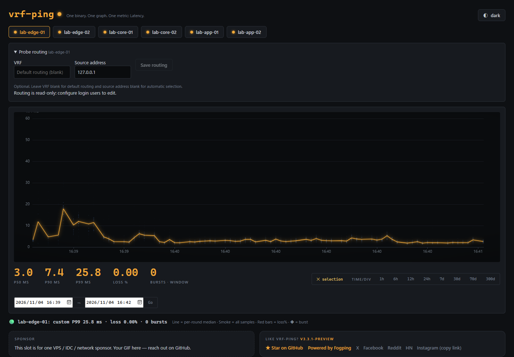

# vrf-ping

<picture>
  <source media="(prefers-color-scheme: dark)" srcset="docs/brand/vrf-ping-logo-dark.svg">
  
</picture>

A lightweight SmokePing alternative with optional per-target VRF and source-address binding. ICMP/TCP probes, latency distributions, packet loss and history. Single Go binary, plain JSONL storage.



*Actual UI from a native development build, measuring six TCP targets in an isolated loopback lab.*

## Install

Linux amd64; other builds are available in [Releases](https://github.com/githubflyideas/vrf-ping/releases).

```bash
set -e
curl -fLO https://github.com/githubflyideas/vrf-ping/releases/download/v3.3.14/vrf-ping-linux-amd64.tar.gz
curl -fLO https://github.com/githubflyideas/vrf-ping/releases/download/v3.3.14/SHA256SUMS
sha256sum --ignore-missing -c SHA256SUMS
tar -xzf vrf-ping-linux-amd64.tar.gz
./vrf-ping --listen 127.0.0.1:8517
```

Build from source: `go build -o vrf-ping .`. Run the binary directly on the host. **Docker is not supported.**

## Targets

Paths are relative to the working directory. Changes reload automatically, normally within three seconds.

A line that does not parse never takes the service down. At startup it is skipped, logged as a `WARNING` and shown in the web UI; the other targets start. While running, a list with a bad line is refused as a whole and the last good set keeps probing — so no other edit to the lists applies either until the line is fixed. The web UI shows that refusal (and `GET /api/health` reports it) for as long as it lasts.

**`targets/ping.list`**

```text
1.1.1.1 ens18
1.1.1.1 eth0-zone1 vrf=zone1
8.8.8.8 ens18-source source=192.168.10.2
8.8.8.8 ens18-base vrf=base_vrf0 source=192.168.10.2
```

**`targets/tcp.list`**

```text
1.1.1.1:443 eth0-zone1-https vrf=zone1 source=192.168.10.2
```

**`targets/http.list`**

```text
app.example.com:443 api-health path=/health expect_status=200 vrf=zone1 source=192.168.10.2
10.0.0.5:8080 intranet scheme=http
```

Format: `target[:port] name [vrf=NAME] [source=LOCAL_IP]`.

- An `http.list` line times the first byte of an HTTP(S) request, through the same VRF, source address and DNS scope as the TCP probe. After `host:port` it takes `scheme=https|http` (default `https`; the certificate is always verified, and there is no switch to skip that), `method=GET|HEAD`, `path=/x` (starts with `/`, a query string is allowed), `host_header=NAME`, `expect_status=N` (default: any status below 400 counts as up) and `follow_redirects=true`. A word an http line does not know is an error that names it. A response with a bad status counts as loss; a name that does not resolve or a VRF that cannot be used is a probe error, as for TCP.
- Names must be unique. `ens18` and `eth0-zone1` are labels, not interface bindings.
- Both options are independent and optional. Omit them for the default routing domain and automatic source selection. Replace example source IPs with local addresses valid in the selected routing domain.
- VRF requires Linux, an existing VRF and sufficient socket permissions. The program does not configure networking or silently fall back on binding failure. ICMP is currently IPv4-only.

## Run and Web UI

```bash
./vrf-ping --listen 0.0.0.0:8517 user=admin passwd='YOUR_PASSWORD'
```

To keep the password out of `ps` and shell history, give it as `VRFPING_PASSWD=... ./vrf-ping user=admin` or `./vrf-ping user=admin passwd-file=/etc/vrf-ping.pw` (one password per line, `chmod 600`); `VRFPING_USER` and `VRFPING_PASSWD_FILE` work too.

Use `--localhost` for loopback-only access; `--help` lists options. Restrict access to trusted management networks.

Before restarting a service, `./vrf-ping --check` with the same arguments says whether it would start and why not (login, token, working directory, target lists, port), without writing anything. Every start logs a short security summary; anything exposed is marked `!`.

The first 5 wrong passwords from one client address are only delayed; the 6th locks that address for 30 s, and each further miss doubles the lock up to 15 min; even the right password is refused (HTTP 429) until the lock runs out. The session cookie is `vrfping_session` (it was `pingping_session`, which clashed with a pingping console on the same host); signing in again after the upgrade is expected.

Authenticated users can edit an existing target under **Probe routing**. Web writes are disabled when login is not configured.

Web settings are stored in `targets/routing-options.json` and **override list-file routing options, including empty values**. Remove a target's JSON entry to restore list-file control. Lists use `source=`; JSON uses `source_address`. Failed reloads retain the active configuration and retry.

## Zabbix (optional)

Off by default. `VRFPING_ZABBIX_TOKEN=<16+ characters> ./vrf-ping --zabbix user=admin passwd=...` (or `VRFPING_ZABBIX_TOKEN_FILE` / `--zabbix-token-file`) serves a read-only `GET /api/stats`: per target, the last five minutes' p50/p90/p99, loss, loss bursts and `probe_errors` (rounds that could not probe at all, such as a missing VRF). No hosts, VRFs, source addresses or raw samples. Use it with the [fogping Zabbix 7.0 template](https://github.com/githubflyideas/fogping/tree/main/zabbix/template_fogping/7.0): set `{$FOGPING.URL}` to `http://<host>:8517`. Item ids derive from the target name, so a rename starts a new item. Without `--zabbix` nothing changes. `./vrf-ping --gen-token zabbix.token` makes a strong token in a file only you can read (it is never printed).

## HTTP API

The web UI and the Zabbix template use one JSON API: [docs/API.md](docs/API.md) · OpenAPI 3.1: [docs/openapi.yaml](docs/openapi.yaml).

## Data and upgrades

`data/` contains daily JSONL files with a default retention of 300 days. Different VRF/source contexts have separate histories. Clearing both options returns to the target's default-context history.

Back up the complete `targets/` and `data/` directories, stop the old process, replace the binary and retain the working directory.

[Testing](docs/testing-routing.md) · [Apache-2.0](LICENSE). Linux VRF behavior is tested; native VyOS images are not certified.
